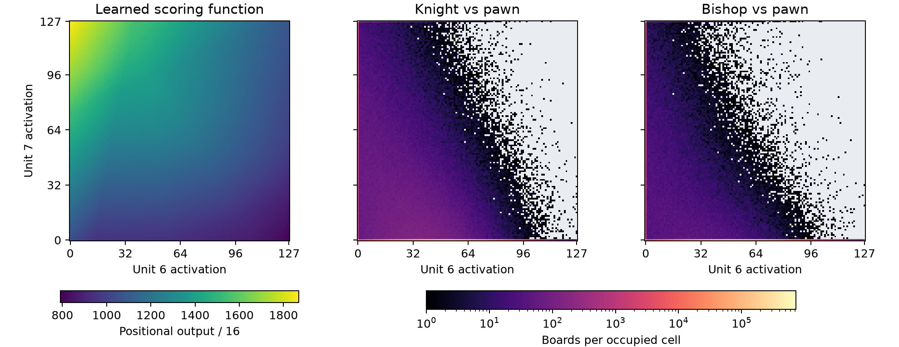

# What SF14.1 sees in quiet four-man endings

A black pawn's race against a white knight or bishop occupies a narrow part of the released eight-unit NNUE bottleneck. On 8,893,661 legal horizontal-reflection representatives, substituting six constants and preserving the remaining two coordinates and the learned direct piece-square score reproduces 98.44% of the native integer evaluations. A two-piece pursuit game explains many of the network's preferences between legal moves. Its exceptions, positions with equal chess outcomes, all 256 bottleneck interchanges, and independent played alternatives distinguish the scope of the explanation. [Per-board compression](results/compressed-head.csv) · [Exhaustive move comparisons](results/race-unit-census.csv)

The follow-up classifies all 295 reversed bishop comparisons and replays every thirteen-ply residual. In 2,830 matched rook and queen comparisons, the same pawn-escort dependency travels through different hidden coordinates. [King geometry and neural interventions](kings/README.md)

## Data and decisions

All boards come from the specified [four-man atlas](../README.md). A sibling pair fixes both kings, the black man, material and at least one common source for the two White moves. Both moves are quiet, keep both kings out of check, and have the same full SF14.1 classical evaluation. The additional quiet filter rules out every immediate legal Black capture or promotion after either move. Search and network scores are from Black's perspective. The primary informative pairs have distinct Syzygy WDL signs. Accurate sorting earns one point and a tie earns half. The target is the fresh-clock sign of the five-category tablebase result under continued play. Repetition claims and an increasing fifty-move clock are outside this history-free experiment.

The enumerated replication sample has 18,483 informative pairs, the April–September 2013 Lichess sample has 276. We extended the identical deterministic screening and within-game sample rule to 1,475,638 rated games in October–December 2013. This gave 8,684 played parents with a quiet alternative, 4,689 quiet classically tied pairs and 240 informative pairs. One move was played and the alternative was drawn from legal moves by the same piece. Dates separate the two game panels. Positions and underlying endgame patterns can recur across games. The new calendar panel checks the earlier quiet-gap observation. The more specific two-coordinate and pawn-race analyses were developed while inspecting these panels. Their complete finite-domain counts establish their scope inside the enumerated material classes. The previous, fresh and enumerated NNUE accuracies are 95.29%, 91.46% and 77.80%. The frozen 48-rule evaluator scores 63.41%, 63.75% and 73.56%. [Game archives](https://database.lichess.org/) · [Paired comparisons](results/conditional.csv)

## A two-piece chess explanation

Erase the kings. Black moves its pawn first and chooses a single push, a legal initial double push, or a capture of the minor. White's knight or bishop can move or wait. The pawn escapes if it captures the minor or promotes on a square that the minor cannot immediately capture. The defending minor stops the pawn by capture or by leaving it without an advance. A second version leaves both king squares as fixed impassable obstacles. These small games model the timing of interception. They omit king moves, royal checks and support from the kings.

The table is solved exactly from the promotion rank backwards. For each minor square and pawn square, Black can escape if it has some advance after which every White response leads to a previously solved escape. White may also immediately capture the advanced pawn. When testing a two-square advance we check its intermediate square for occupancy. A separate recursive implementation checked the bitboard solution on 9,932 sampled reduced-game states. We evaluated the predictors on every eligible, mirror-canonical same-source pair. Pairs with multiple common source squares contribute once.

| Full paired census | Knight vs pawn | Bishop vs pawn |
|---|---:|---:|
| Quiet, equal-hand-score pairs including equal WDL | 17,796,704 | 33,999,740 |
| Pairs where WDL differs | 1,469,778 | 1,359,347 |
| Bare race ranks the pair correctly / incorrectly | 996,179 / 9,375 | 955,808 / 295 |
| Bare race ties the pair | 464,224 | 403,244 |
| Native NNUE accuracy on those race ties | 78.71% | 78.26% |
| Native accuracy where the bare race points the wrong way | 53.09% | 35.25% |

The simple race orders 99.07% and 99.97% correctly conditional on both a strict race prediction and a strict real outcome. It also produces a preference on 1,370,050 knight pairs and 322,919 bishop pairs with *equal* real WDL. On those equal-outcome pairs NNUE favors the race direction in 62.21% and 57.67%, respectively, with half credit for a neural tie. An ordering on equal WDL can encode other properties such as conversion difficulty. The rule and NNUE partly share a geometric preference, and their failures have measurable support. Treating king squares as obstacles raises bishop race accuracy on all informative pairs from 85.15% to 87.50%, and lowers knight race accuracy from 83.57% to 82.78%. [Full joint order counts](results/race-order-counts.csv) · [Independent sibling-generation check](results/race-pair-audit.csv)

One fresh example has White Kd3, Bf1 against Black Kf2, Pe3. Both Be2 and Bh3 receive classical zero. Be2 blockades the pawn and draws. After Bh3 the sole winning reply is ...e2. SF14.1 assigns the two resulting boards +106 and +1016 from Black's perspective. In another fresh game, a rook check decided the game and the native network preferred the losing White choice. [Moves, positions and optimal replies](results/played-examples.json)

On the same 240 fresh quiet pairs SF12 raw NNUE scores 69.38%, SF14.1 91.46%, and the SF18 raw large network 89.79%. Removing all explicit attack features in the latter gives 84.17%. The two-coordinate finding below concerns the SF14.1 architecture. [Cross-generation results](results/game-generations.csv)

## Where the signal travels

We read the eight first-hidden-layer bytes, 32 second-hidden-layer bytes, positional raw sum and direct piece-square raw sum from the pinned SF14.1 network. For a pair we interchange all subsets of the eight hidden coordinates. On subset S, copy the other child's values into the coordinates outside S, repeat with the other endpoint as donor, and average the two ordering credits. Each recipient keeps its own direct piece-square term. The exact integer head and truncation are replayed for every intervention. The full subset recovers native scores. Discovery of useful subsets uses the enumerated comparisons, with the two game panels reported separately. Hybrid activations can be outside the distribution of ordinary positions. [All subset sizes on three panels](results/unit-subsets.csv) · [Per-unit Shapley and removal effects](results/unit-effects.csv)

For the exhaustive minor-pawn tests the bottleneck coordinates are numbered 0–7 in engine order. Allow just 6 and 7 to differ, then allow only the other six to differ. Over all 1,469,778 informative knight pairs the two results are 86.37% and 48.00%, against native 86.03%. Over the 1,359,347 bishop pairs they are 89.90% and 49.98%, against native 89.85%. Even *within the bare race ties*, retaining the pair achieves 78.81% on knights and 78.49% on bishops. Thus these coordinates also carry information absent from the bare race bit. In the 43 fresh knight and 27 fresh bishop comparisons, keeping these two coordinates retains the native aggregate accuracies of 94.19% and 96.30%. [Exhaustive intervention counts](results/race-unit-census.csv) · [Game replication](results/race-replication.csv)

At five plies, partition informative pairs by which material-conversion labels are needed for a neutral-frontier preference. For 57 fresh cases where promotion labels are necessary and elementary capture labels dispensable, keeping 6 and 7 gives 94.74%, removing them gives 42.11%. For 65 fresh cases with the reverse requirement, the intact network scores 90.00% and removing the two gives 93.08%. Material explains much of this contrast. Exact matching on material leaves only three matched-weight observations per side in the fresh data and 33 on the enumerated panel. A specific interpretation as promotion detectors would require within-material evidence. [Causal subset contrasts](results/frontier-unit-effects.csv) · [Overlap controls](results/matched-unit-effects.csv)

### An exact two-coordinate head on a measured domain

The first panel shows the learned positional output on the two-coordinate surface. The right panels count actual boards on that surface. Gray cells were unoccupied.

Set the first six hidden bytes to their joint modal vector (0, 127, 0, 127, 0, 127). Precompute the unchanged 32-unit upper transform and positional output on all 16,384 possible values of units 6 and 7. Add the original piece-square score and apply the released integer scaling. On the subset where the six coordinates already equal the constants, the substitution is an identity. The procedure still requires computing coordinates 6 and 7 from the original front end.

| Single-board reconstruction | Knight vs pawn | Bishop vs pawn |
|---|---:|---:|
| Canonical legal boards | 4,572,488 | 4,321,173 |
| Boards exactly on the constant six-coordinate surface | 4,500,490 | 4,252,796 |
| Exactly reproduced final integer scores | 4,501,366 | 4,253,754 |
| Mean absolute error in native integer score | 0.77 | 0.64 |
| Largest absolute error | 1,065 | 1,109 |

The two remaining coordinates interact. On the constant surface the positional head is F(u,v). Every additive candidate f(u)+g(v) has zero mixed difference on four rectangle corners. A measured mixed difference D therefore forces a maximum absolute raw error of at least |D|/4. Requiring at least ten real boards at each corner, the largest differences are 5,611 for knights and 4,061 for bishops. Even an optimal additive least-squares fit weighted by the actual board frequencies has a minimum raw RMS error of 163.51 and 93.01 on the two surfaces. These units precede division by 16 and the addition of the direct branch. Score reconstruction and WDL ranking have different objectives. The unweighted-grid additive projection gives poorer absolute scores, yet ranks 88.16% and 92.04% of the informative pairs correctly. [Activation frequencies](results/unit-occupancy.csv) · [Raw grid bound](results/head-grid.csv) · [Realized four-corner bounds](results/realized-head.csv) · [Ranking test](results/race-unit-census.csv)

## How much future play suffices?

At the first capture or promotion, reveal the continuation result. A promotion capture belongs to promotion. Reveal checkmate and stalemate reached before material changes, including terminals exactly at the depth horizon. Assign every surviving unconverted horizon node either the full interval [−1,+1] or neutral value zero. Minimax backs these values up over every legal move. Four disjoint label classes can be switched independently. They cover elementary non-pawn captures, captures leading to king-and-pawn against king, promotions, and terminals reached without conversion. Elementary capture outcomes follow from remaining material, immediate legal recapture, checkmate and stalemate. The other two material-changing classes use Syzygy at the exit. An unrevealed exit is opaque. The competent adversary, finite horizon and exit convention specify what counts as an explanation here.

**Interval decision rule.** The lower and upper backups L and U enclose the true WDL by induction. Replacing every unresolved Black-perspective leaf by a common value t produces a unary expression in min, max and constants. By induction that expression is the projection of t onto [L,U]. For a maximizer take the maxima of the two lower and upper endpoints, and analogously take minima for a minimizer. On the three-value scale a strict preference between neutral projections guarantees a weak true order. One projected endpoint must be +1 or −1 and thereby certify its side. For example a certified win can safely outrank a still unresolved win-or-draw. More generally L(A) ≥ U(B) certifies A at least as good as B, including touching intervals whose neutral projections tie. A strict inequality certifies a strict outcome advantage. The endpoint condition is necessary for a universal guarantee over independent interval completions. On any comparison where the endpoint test is decisive, using it before an arbitrary secondary ranking preserves or improves the chosen WDL. For general numerical payoffs, neutral preferences alone can reverse truth. Intervals [1,1] and [0,2] with actual values 1 and 2 give this counterexample.

The explicit tree evaluates all 16 information masks at depths through five on the enumerated sample and seven on the selected games. A second threshold solver runs to 13 plies for the fully revealed case. At an OR node the proving side needs one successful move, at an AND node it needs all legal replies. The implementation uses an orthodox tablebase label at interior nodes to reject impossible threshold goals. Every successful strategy still bottoms out at the specified exits or terminals. Both solvers reproduce the same bounds at overlapping horizons. A separate python-chess recursion checked 824 interval triples on 412 sampled children. The fully revealed test is an oracle-assisted explanation of a move choice. The elementary-capture-plus-terminal version computes the same rule with no tablebase labels. [All four label channels](results/horizons.csv) · [Scalar audit](results/independent-audit.csv)

In the 240 fresh informative comparisons the neutral model gives a preference on 138 by five plies, 162 by seven, and 210 by thirteen. Fully separated outcome intervals occur on 30, 47 and 83 pairs. A neutral tie remains on 30 at thirteen plies, with NNUE still reaching 80.0% there. Of 29 fresh queen-versus-pawn comparisons, only five give a neutral preference by seven plies, while the network scores 28/29. On the 21 fresh rook-versus-rook pairs the seven-ply neutral model orders all correctly and the network earns 15.5/21. [Material breakdown](results/material.csv) · [Per-game proof depths](results/proof-onsets.csv) · [Thirteen-ply results](results/proof-depths.csv)

At thirteen plies on the 18,483 enumerated comparisons, 3,317 have strictly separated bounds and 13,892 have a neutral preference. The interval rule additionally resolves 2,355 touching-bound cases, giving 16,247 weak preferences. On fresh games it gives 212 weak preferences, including 83 strict separations. Using the interval choice first and the neural score otherwise earns 96.14% on the enumerated pairs and 98.33% on the 240 fresh pairs. This hybrid uses Syzygy at promotions and at captures leading to pawn endings. [Enumerated proof depths](results/enumerated-depths.csv) · [Interval decisions and paired utility gains](results/interval-decisions.csv)

The outcome-independent policy test keeps all 4,689 quiet HCE ties in the new games, including the 4,449 pairs with equal true WDL. With five plies and only elementary capture and terminal information, the neutral rule ahead of NNUE improves expected WDL on nine roots and harms zero. With all four types of information it improves 12 and harms zero, an average gain of 0.00267 per eligible root. Pairs with equal true outcomes frequently receive a strict score preference. Correct-score rates from the preselected informative pairs therefore require their own denominator. [All quiet roots](results/unselected-policy.csv) · [Complete interval comparison including touching endpoints](results/interval-decisions.csv)

### A missing answer can have a one-move explanation

In the fresh game boieijcd White has Ka5 and Qb8 against Kg2 and Pf3. Qb6 permits ...f2, Black's sole drawing move. Qb7 pins the f3-pawn to Kg2 along the b7–g2 diagonal and wins for White. The specialized hand evaluator reads the kings and the pawn in this material class and omits the queen square. The classical scores are both −2494. NNUE gives −17 and −889. The conversion-based neutral test ties even at 13 plies. Suppress just ...f2 after Qb6, with every other reply and all subsequent chess rules intact, and Syzygy changes Black's draw to a loss. The long conversion horizon and the short legal explanation describe the same preference at different levels.

We exhaustively compared a pinned and unpinned child with the same fixed pawn and kings, two legal moves from a common source, equal full classical score and no immediate Black capture or promotion. The square in front of the pawn must be empty in both, the pawn must have a single push in exactly the unpinned position, and ranks permitting promotion or a double push are excluded. Require a strict advantage for the unpinned position which disappears or reverses when just that advance is removed, with at least one alternative left. There are 27,605 queen, 4,500 rook and 1,137 bishop pairs. NNUE ranks 97.82%, 76.96% and 54.53% correctly respectively, counting ties by halves. This sharp material dependence survives an identical geometric definition and causal test. Eight fresh queen comparisons meet these conditions. All eight are correctly ordered. Two remain neutral ties at thirteen plies. [Exact pin counts](results/pin-census.csv) · [Independent game replay](results/played-pins.json) · [Game and generated replication](results/pin-replication.csv)

The IJCAI work compares decodable chess concepts in Stockfish. Jenner and colleagues study future moves in a Leela policy network. Here the reduced pawn game gives a falsifiable chess prediction, the frozen two-coordinate function reconstructs a released static head, and bounded strategies certify specific leaf comparisons. An observed match to a thirteen-ply preference quantifies agreement with that game calculation. Identifying an internal search procedure would require a different intervention. [IJCAI concept study](https://www.ijcai.org/proceedings/2023/541) · [Leela future-move experiments](https://arxiv.org/abs/2406.00877)

## Reproduction

Start with the completed four-man atlas scratch tree and its pinned SF14.1 traces, Python dependencies (including Matplotlib for the figure) and tablebases. The following command downloads the three further Lichess months, verifies their digests, builds the isolated native driver and repeats the enumerations, interventions and independent checks. Raw boards, network weights, engine binaries and temporary search tables live in scratch.

~~~bash
bash research/nnue-tempo/atlas/horizon/run.sh .scratch/nnue
~~~
