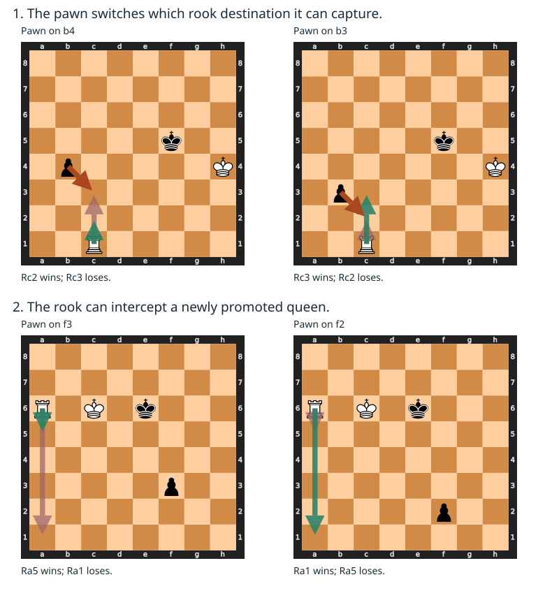

# What the KRvKP formula misses

This directory follows the actual rook-versus-pawn witnesses in the [earlier collision test](../circuits/results/handwritten-collisions.csv). All reported engine scores are static Stockfish 14.1 scores. A comparison contains four legal children from two white rook moves, A and B, before and after displacing one black pawn. The candidate moves, both kings and all remaining material stay fixed. Syzygy labels use the sign of WDL, including cursed wins as wins and blessed losses as losses. The positions have no en-passant or castling rights. [Syzygy probing conventions](https://python-chess.readthedocs.io/en/latest/syzygy.html)

## The 19 original successes

The released KRKP function has four branches. The first checks whether the stronger king is in front of the pawn on its file. The second checks whether the weaker king is distant from its pawn and at least three king steps from the rook. Both return 1,380 minus the stronger king's distance to the pawn. The third handles an advanced, king-supported pawn. Its score depends on the stronger king's distance to the pawn. The fallback uses both kings' distances to the square in front of the pawn and the pawn's distance to promotion. The only test of the rook square anywhere in this function is that three-step distance threshold in the second branch. All 152 discovery-child scores were reconstructed as native integers. [Stockfish source](https://github.com/official-stockfish/Stockfish/blob/7262fd5d14810b7b495b5038e348a448fda1bcc3/src/endgame.cpp#L179-L215)

| Best defense required in one or both inferior children | NNUE double successes |
|---|---:|
| The black pawn must take the rook in both inferior children, on alternating destinations | 7 |
| The black pawn must take the rook in one inferior child | 7 |
| Immediate promotion is necessary in the edited inferior child | 5 |

For each case we enumerated every legal black reply and probed its unrestricted continuation. Restricting pawn captures of the rook for exactly one reply destroys the strict WDL reversal in the first 14 cases. Restricting immediate promotions destroys it in the other five. In those five, playing B allows the rook to recapture a forward queen promotion, while A allows the queen to survive the immediate rook reply. Three of the five also have an original inferior child where the black king must take the rook. In 17 cases the handwritten evaluator ties the two rook moves in both contexts. In two it preserves a nonzero preference of identical size across the pawn shift. The [38-case ledger](results/seed-cases.csv) includes the earlier 19 misses and the [reply data](results/seed-replies.json) include all legal defenses.



## Transfer and controls

The [frozen design](design.md) specifies the geometric strata before fresh scoring. Draw 36,000 comparisons across seven material classes and a separate 28,000 comparisons with uniformly sampled candidate pairs from the eligible quiet alternatives. One placement may enter different designed strata. In 3,233 of the 4,500 designed double-diagonal cases the best of the two moves switched as predicted. Restricting only the black pawn's immediate capture of the candidate piece eliminated all 3,233 switches. NNUE strictly selected both moves correctly in 1,415 cases, and classical evaluation did so in three. Bishops and knights from a fixed square always land on squares of the same color, while the two alternating pawn-capture squares have opposite colors. Their single-exposure tests remain meaningful. In the random-pair sample 23 of 28,000 cases had double-diagonal exposure. Counts from the designed strata describe that intervention, not game frequencies. [All family counts](results/transfer.csv) · [Random-pair and independent replay counts](results/audit.csv)

The independent audit replayed 256,000 child observations and compared 2,520 sampled positions with an unmodified Stockfish binary. Cases can share child positions. There were 123 designed cases where the restricted value was undefined or could not be resolved from the available successor tables. Every forward reversal in the three motif strata had a resolved restricted value. The restricted game resumes normal chess after the single constrained reply.

Enumerating both kings for the 37 distinct original piece-and-destination templates gave 61,715 valid placements after excluding their original king pairs. Of 26,445 forward WDL reversals, NNUE got both choices right on 13,998. In another 8,033 the numerical margin shifted in the correct direction without producing both correct choices. Even among neighboring king placements with identical four WDL labels, success can change. Neighbor comparisons overlap. [Complete king sweep](results/king-sweep.csv) · [One-square king edits](results/neighbor-kings.csv)

A ridge readout learns the oriented pawn-exposure signal from the mixed difference of the 2,048 clipped feature slots on 1,570 discovery KRvKP comparisons. Use a reflection-invariant king-pair split for training and testing and freeze the weights for transfer. The raw accumulators' mixed differences are zero on every traced example. The experiment equalizes each clipped feature's increment across contexts and recomputes the original downstream network. It restores the highest-weight readout slots or an equal number drawn within the same bins of discovery RMS interaction. Decodability and causal influence are measured separately. In 7,740 matched controls, changing the pawn file leaves its ranks, kings, moving piece and both candidate moves intact; a valid nearby file removes the pawn capture or the promotion interception. [Held-out readouts and interventions](results/channels.csv) · [Matched file controls](results/matched-files.json)

Two additional handcrafted penalties describe a legal pawn capture of the moved piece and a legal forward queen promotion which the moved piece cannot immediately capture. The coefficients were fitted only on the KRvKP discovery fold, keeping the original evaluator's coefficient fixed. Applying them to the original score on 748 informative held-out random KRvKP move comparisons raised accuracy from 57.8% to 71.7%, with 85.2% for native NNUE. Tied evaluator choices receive half credit. Among the 512 comparisons where the two features agree between moves, accuracy was 62.4% for the original formula and 88.3% for NNUE. These tests also include the full classical evaluator with lazy cutoffs disabled and scores taken before the grain truncation. Approximate paired intervals cluster both contexts by the symmetry-reduced king pair. [Results by material and rule](results/two-rules.csv)

## Pin and played-position checks

For an absolute pin, add a white rook on the black pawn's file with the black king behind the pawn. Keep the attacking pawn and both possible destinations unchanged. The pawn geometrically attacks the same squares in every condition. It cannot legally capture the moved piece while pinned. Move the pinning rook one file sideways to release the pin, and then a second file in the same direction for a displacement control. Accept all twelve child boards only if the other rook cannot be taken and the two unpinned contexts have identical pawn-capture availability. These three five-man material classes add 4,000 comparisons with three conditions each.

In the two-rook double-exposure test the KRvKP-trained probe continued to report the geometric direction on 96.0% of pinned cases and 93.8% of unpinned cases (400 paired tests). Native score direction on 1,000 cases was 88.3% and 88.7%. The separate rook-and-bishop single-exposure test showed a larger native change after releasing the pin, 54.5 internal units after subtracting the second displacement control (king-clustered 95% interval 41.5 to 67.5). These controls show both persistence of geometric sensitivity in the absence of a legal capture and material-dependent sensitivity to the surrounding position. The rook displacement can affect other chess relations as well. The probe tests orientation of the move margin. Its percentages are not WDL accuracy. [Pin controls](results/pins.csv)

Scan the complete January, February and March 2013 Lichess rated archives, totaling 403,928 games. At each eligible actual parent, compare the move that was played against a different quiet nonchecking move by the same piece. Choose one eligible parent per game and material by reservoir sampling; choose its alternative uniformly. Mirror colors when needed. Exclude any exact KRvKP training parent or edited training parent. The game validation has no synthetic pawn edit. There were 2,938 comparisons from 2,908 games, with 693 strict differences in tablebase outcome. The released classical evaluator selected the better move on 67.4%, the two penalties added to it on 83.9%, and NNUE on 92.7%. The paired gain from the rules was 16.5 percentage points (game-clustered 95% interval 14.6 to 18.4). On 333 comparisons where the two rule indicators agree, classical and augmented scores have the same margin, with 68.6% accuracy, while NNUE reaches 89.3%. The test samples quiet same-piece choices in seven material classes. [Played-position results](results/played.csv) · [Game archives](https://database.lichess.org/)

## Reproduction

From the repository root, use a scratch directory with the baseline data, pinned python-chess tablebases and the instrumented feature probe from the [previous experiment](../circuits/README.md). The three game archives and their digest checks are described in the previous experiment. The runner downloads three more WDL files for the absolute-pin controls. Per-position activation data stay in scratch. The downloadable tables, unmodified binary and evaluator source should match the pinned baseline.

```bash
bash research/nnue-tempo/pawn-geometry/reproduce.sh .scratch/nnue research/nnue-tempo/pawn-geometry/results
```
